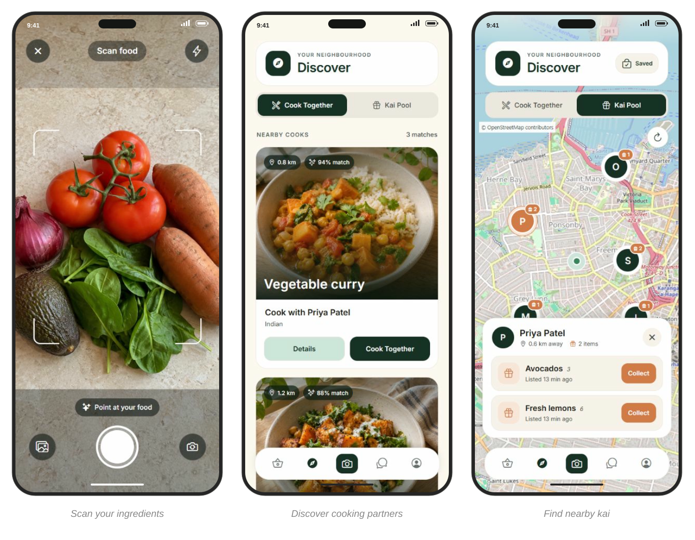
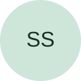

# Kai Pool

<br>

<p align="center">An app for sharing spare food and finding people nearby to cook with.</p>

<p align="center">Our team built Kai Pool in 48 hours for the AUT AI Hackathon Festival 2026, placing second overall.<br>
Auckland City Mission’s Food Security team later contacted us to learn more about the project.</p>

<br>

<p align="center">
  
</p>

<br>

## Features

- AI food recognition from pantry or fridge photos.
- A personal food pool for keeping, sharing or giving away ingredients.
- Nearby food giveaways on an interactive map.
- Cooking matches based on location, ingredients and food cultures.
- AI meal suggestions, cooking invitations and cookout planning.

## Running locally

You'll need Node.js, npm, Java 21 and Git.

Copy [`backend/.env.example`](backend/.env.example) to `backend/.env` and add your own database credentials and Gemini API key.

Install [Expo Go](https://expo.dev/go) on your phone. For SDK 57, sign into the same Expo account on your phone and computer: run `npx expo login` from `frontend` once.

**Windows**
```powershell
.\start.cmd
```

**macOS / Linux**
```bash
bash start.sh
```

Open the app in Expo Go using the displayed QR code. Keep your phone and computer on the same Wi-Fi. [Demo accounts](backend/DEMO_USERS.md) are available when using the development seed data.

<br>

## How it started

<blockquote>
<p><em>Kia ora, ko Shyam tōku ingoa.<br>
Me tīmata ahau ki tētahi mea, tata ki toku ngakau.<br>
Nō Inia ahau, he manene hoki,<br>
Engari, kaore ano toku hono ki Aotearoa kia tino kaha.</em></p>

<p><em>Hello everyone.<br>
My name is Shyam, and I'm from an Indian migrant background.<br>
When I first arrived in Aotearoa, one of the hardest things was finding a sense of belonging.<br>
Personally, I found that belonging with food.<br>
It helped me feel more connected to my hapori.</em></p>

<p><em>That experience inspired us to create Kai Pool: kai meaning food, and pool meaning to share.<br>
It brings cultures, communities, and people together over food.</em></p>
</blockquote>

<br>

## Contributors

<table>
  <tr>
    <td align="center" valign="top" width="1000">
      <br>
      <a href="https://github.com/LeoCaoProjects"></a>
      <p><a href="https://github.com/LeoCaoProjects"><strong>Leo Cao</strong></a><br>Developer &amp; designer</p>
      <br>
    </td>
    <td align="center" valign="top" width="1000">
      <br>
      <a href="https://github.com/fatehbhular"></a>
      <p><a href="https://github.com/fatehbhular"><strong>Fateh Bhular</strong></a><br>Developer &amp; tester</p>
      <br>
    </td>
    <td align="center" valign="top" width="1000">
      <br>
      <a href="https://github.com/ShawnLeeyz"></a>
      <p><a href="https://github.com/ShawnLeeyz"><strong>Shawn Lee</strong></a><br>Developer</p>
      <br>
    </td>
  </tr>
  <tr>
    <td align="center" valign="top" width="1000">
      <br>
      <a href="https://www.linkedin.com/in/shyam-sharma-103920362/"></a>
      <p><a href="https://www.linkedin.com/in/shyam-sharma-103920362/"><strong>Shyam Sharma</strong></a><br>Business &amp; pitch</p>
      <br>
    </td>
    <td align="center" valign="top" width="1000">
      <br>
      <a href="https://github.com/LongNightOfSolace2552"></a>
      <p><a href="https://github.com/LongNightOfSolace2552"><strong>Wei-Xiang Yong</strong></a><br>Developer</p>
      <br>
    </td>
    <td width="1000"></td>
  </tr>
</table>
